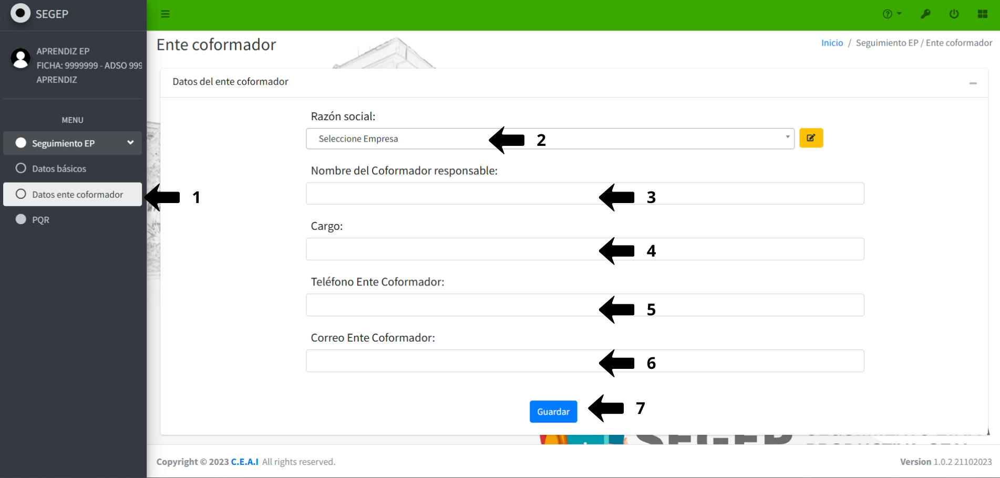
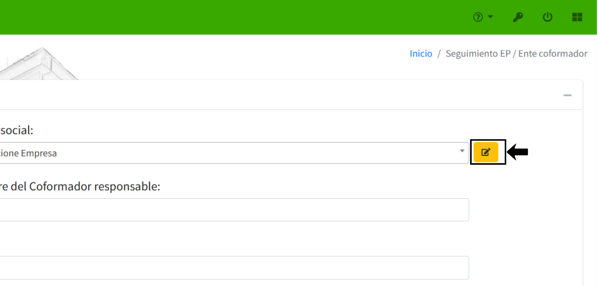
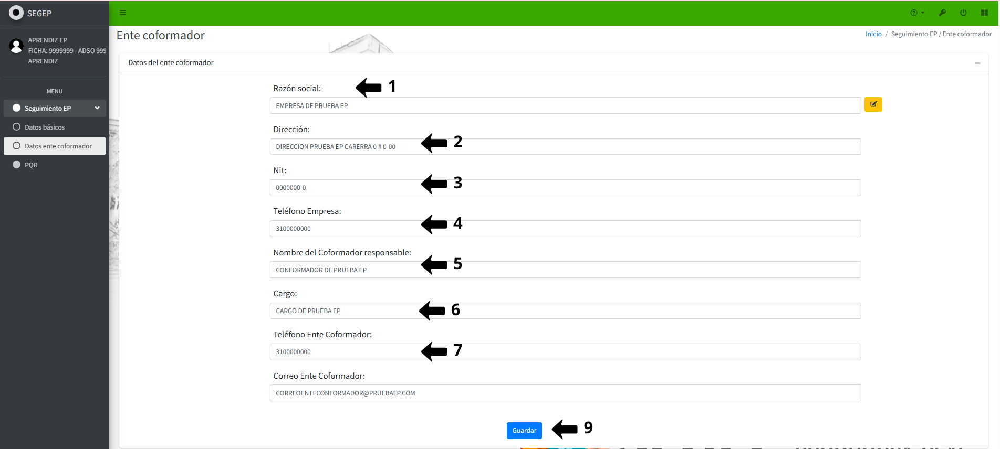

# 📘 DATOS DEL ENTE CONFORMADOR

## 1️⃣ **Acceder al módulo de datos ente conformador**

En el menú lateral, bajo **Seguimiento EP**, haga clic en la opción **Datos ente conformador**. El sistema mostrará la interfaz **Ente conformador** con el formulario de **Datos del ente conformador**.

### **Diligenciar Datos del ente conformador**

- En el campo **Razón social**, haga clic en el menú desplegable. Se desplegará una lista con las empresas registradas en el sistema. Seleccione la empresa correspondiente donde realiza su etapa productiva.

- En el campo **Nombre del conformador responsable**, ingrese el nombre completo de la persona responsable de supervisar su etapa productiva en la empresa.

- En el campo **Cargo**, ingrese el cargo o posición que ocupa el conformador responsable dentro de la organización o empresa. 

- En el campo **Teléfono Ente conformador**, ingrese el número telefónico de contacto de la empresa o del conformador responsable.

- En el campo **Correo Ente conformador**, ingrese la dirección de correo electrónico corporativo del conformador responsable o de la empresa.

{: .clickable-image}

### **Guardar la información del ente conformador**

- Una vez completados todos los campos requeridos, haga clic en el botón azul {:.inline-img}.

## 2️⃣ **Editar la razón social (cuando sea necesario)**

Si el nombre o razón social no se encuentra en la lista desplegable, haga clic en el ícono de lápiz amarillo {:.inline-img} ubicado junto al campo **Razón social**. El sistema abrirá un formulario adicional donde podrá editar los detalles de la empresa.

{: .clickable-image}

### **Verificar los datos completos del ente conformador**

Después de guardar, el sistema mostrará todos los datos del ente conformador incluyendo campos adicionales como:

- **Razón social:** Nombre completo de la empresa
- **Dirección:** Dirección física de la empresa
- **Nit:** Número de identificación tributaria
- **Teléfono Empresa:** Número telefónico principal
- **Nombre del conformador responsable:** Nombre completo del supervisor
- **Cargo:** Posición del conformador
- **Teléfono Ente conformador:** Contacto directo del conformador
- **Correo Ente conformador:** Email de contacto

Revise que toda la información sea correcta antes de proceder con otros módulos.

{: .clickable-image}

---