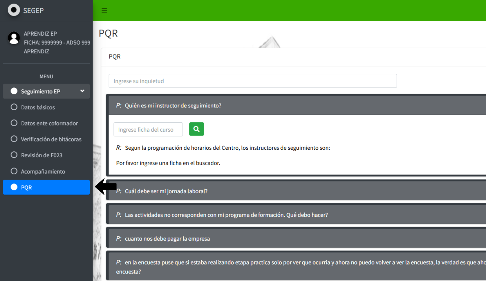
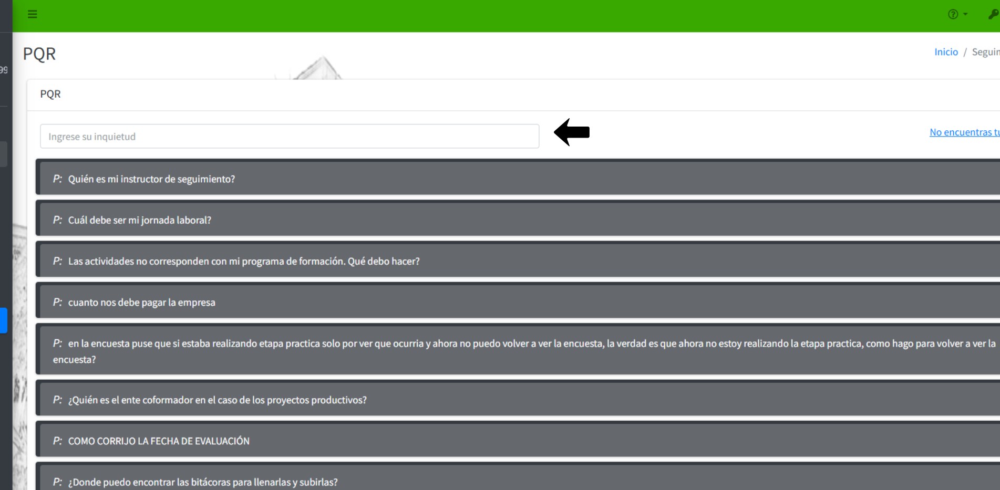
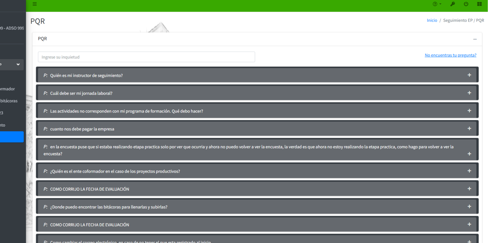
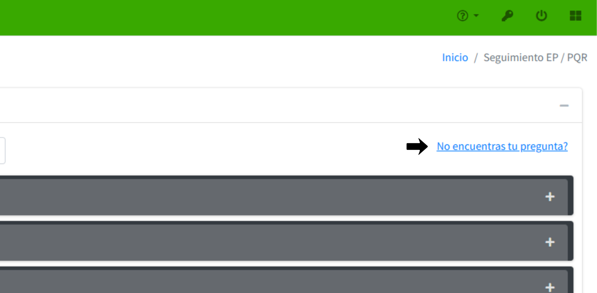
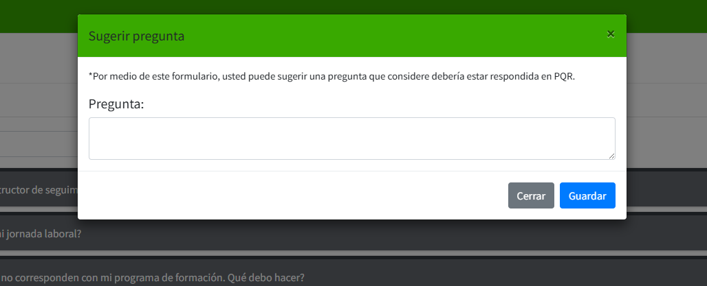

# 📘 PQR - PREGUNTAS, QUEJAS Y RECLAMOS

El módulo PQR (Preguntas, Quejas y Reclamos) permite a los aprendices consultar las preguntas frecuentes relacionadas con el proceso de seguimiento de la etapa productiva. Este espacio ofrece respuestas rápidas a las dudas más comunes y facilita la búsqueda de información específica mediante un buscador integrado.

## 1️⃣ **Acceder al módulo PQR**

En el menú lateral izquierdo, haga clic en la opción **PQR** ubicada debajo de la sección **Seguimiento EP**.

{: .clickable-image}

El sistema cargará la interfaz **PQR** con un campo de búsqueda y una lista de preguntas frecuentes organizadas en secciones desplegables.

## 2️⃣ **Buscar una pregunta específica**

### **Usar el campo de búsqueda general**

En la parte superior de la interfaz se encuentra un campo de texto con el marcador de posición **"Ingrese su inquietud"**:

- Haga clic en el campo de búsqueda.
- Ingrese palabras clave relacionadas con su consulta o duda.
- Presione la tecla **Enter**.
- El sistema filtrará y mostrará las preguntas relacionadas con los términos ingresados.

{: .clickable-image}

**Ejemplo de búsqueda:** Si desea información sobre el instructor, ingrese términos como "instructor", "seguimiento" o "responsable".

## 3️⃣ **Consultar preguntas frecuentes**

El sistema presenta una lista de preguntas frecuentes organizadas en secciones desplegables. Cada pregunta aparece en una barra gris con un ícono de suma {:.inline-img} a la derecha.

{: .clickable-image}

## 4️⃣ **Solicitar ayuda adicional**

Si su pregunta específica no se encuentra en la lista de preguntas frecuentes:

- Haga clic en el enlace **"¿No encuentras tu pregunta?"** ubicado en la esquina superior derecha de la interfaz.

- El sistema abrirá una ventana emergente titulada **"Sugerir pregunta"**.

- Haga clic dentro del campo de texto para activarlo.

- **Redacte su pregunta** de forma clara y específica. Se recomienda:
  - Formular la pregunta de manera directa y concisa
  - Incluir el contexto necesario para su comprensión
  - Evitar preguntas demasiado generales o ambiguas
  - Verificar la ortografía antes de enviar

{: .clickable-image}
{: .clickable-image}

---