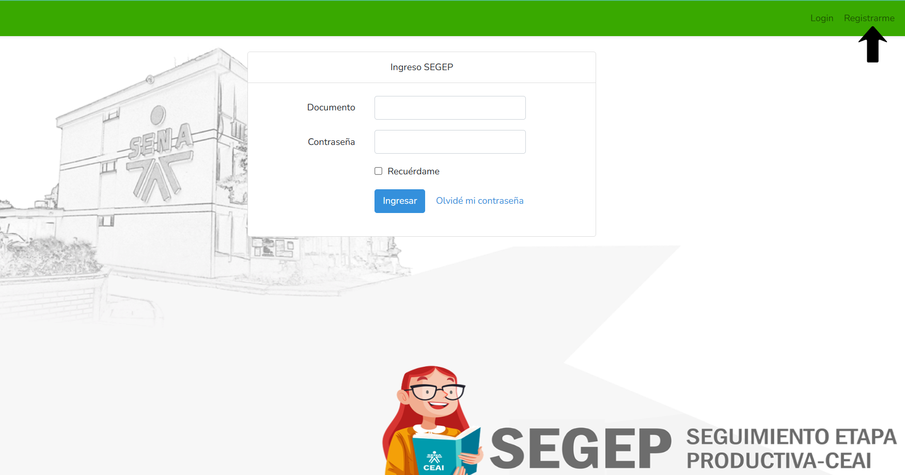
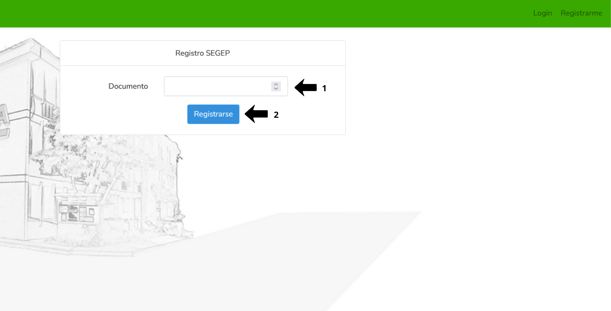

# 📘 REGISTRO DE USUARIO

Este instructivo explica el procedimiento paso a paso para realizar el registro a través del sistema SEGEP.

## 1️⃣ **Ingreso al Sistema**

Acceda al sistema a través del siguiente enlace: [https://productiva.appsceai.com/public/usuarios](https://productiva.appsceai.com/public/usuarios)

## 2️⃣ **Registrarse**

### **Registro**

En el panel superior derecho de la interfaz de inicio de sesión, haga clic en **REGISTRARME**. El sistema lo redirigirá a la interfaz de Registro SEGEP.

{: .clickable-image}

### **Ingresar el número de documento**

- En la interfaz de **Registro SEGEP**, localice el campo **Documento** y complételo con su número de identidad sin puntos ni comas. Verifique que el número ingresado sea correcto antes de continuar.
- Luego haga clic en el botón azul {:.inline-img} ubicado debajo del campo de documento.

{: .clickable-image}

---