# 📘 ACOMPAÑAMIENTO

El módulo de Acompañamiento permite a los instructores registrar y gestionar las visitas de seguimiento realizadas a los aprendices durante su etapa productiva. Estas visitas son fundamentales para asegurar que los aprendices estén aplicando correctamente los conocimientos adquiridos y para brindarles el apoyo necesario en su proceso de formación.

## 1️⃣ **Acceder al módulo de Acompañamiento**

En el menú lateral izquierdo, dentro de la sección **Acompañamiento**, haga clic en la opción **Ver acompañamiento**.

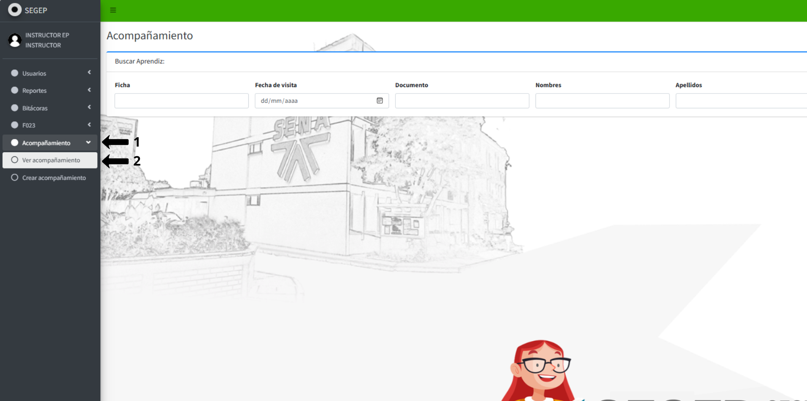{: .clickable-image}

El sistema cargará la interfaz "Acompañamiento" con el encabezado **Buscar Aprendiz** y mostrará los filtros de búsqueda disponibles.

## 2️⃣ **Buscar aprendices para acompañamiento**

El sistema le proporciona múltiples criterios de búsqueda para localizar a los aprendices que requieren registro de acompañamiento.

### **Utilizar los filtros de búsqueda**

Complete uno o varios campos según sus necesidades de búsqueda:

- **Ficha:** Ingrese el número de ficha del grupo de aprendices.
- **Fecha de visita:** Seleccione la fecha en la cual realizó o planea realizar el acompañamiento. Utilice el formato dd/mm/aaaa o el calendario desplegable haciendo clic en el ícono de calendario {:.inline-img}.
- **Documento:** Digite el número de documento de identidad del aprendiz.
- **Nombres:** Escriba el nombre del aprendiz para filtrar los resultados específicos.
- **Apellidos:** Escriba el apellido del aprendiz para filtrar los resultados específicos.
Después de ingresar los criterios deseados, haga clic en el botón azul {:.inline-img} para ver los resultados.

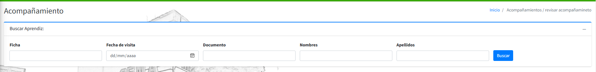{: .clickable-image}

## 3️⃣ **Crear acompañamiento**

Para registrar un nuevo acompañamiento, diríjase al menú lateral izquierdo y haga clic en la opción **Crear acompañamiento**. El sistema mostrará la interfaz para el registro de un nuevo acompañamiento con el título **Listado de aprendices asociados**.

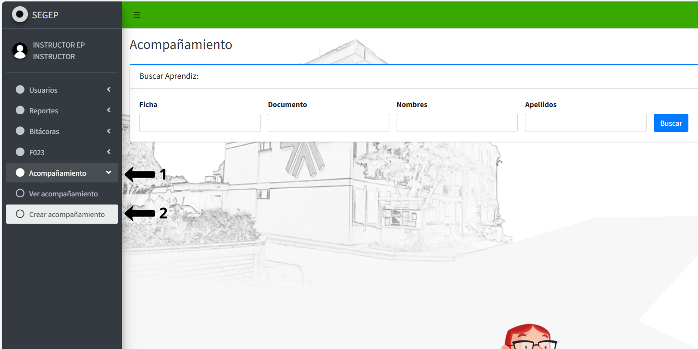{: .clickable-image}

### **Buscar el aprendiz para crear acompañamiento**

En la interfaz de creación de acompañamiento, utilice los filtros de búsqueda para localizar al aprendiz. Complete uno o varios campos según sus criterios:

- **Ficha:** Ingrese el número de ficha del programa de formación.
- **Documento:** Digite el número de documento de identidad del aprendiz.
- **Nombres:** Escriba el nombre del aprendiz.
- **Apellidos:** Escriba el apellido del aprendiz.

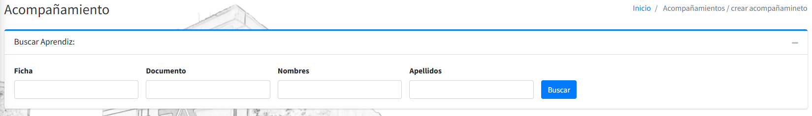{: .clickable-image}

Una vez ingresados los criterios de búsqueda, haga clic en el botón azul {:.inline-img} ubicado a la derecha de los campos de filtro.

El sistema desplegará el listado de aprendices que coinciden con los criterios ingresados.

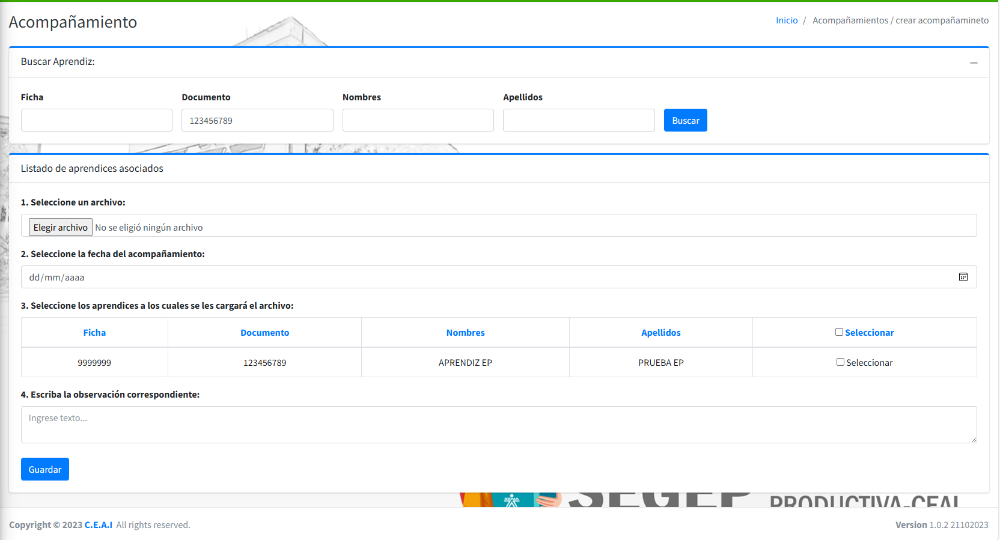{: .clickable-image}

## 5️⃣ **Completar el formulario de acompañamiento**

Una vez localizado el aprendiz, el sistema mostrará un formulario con los siguientes campos que debe completar:

### **Seleccione un archivo:**

- Haga clic en el botón **Elegir archivo**.
- El sistema abrirá el explorador de archivos de su equipo.
- Navegue hasta la ubicación donde se encuentra el archivo de evidencia del acompañamiento (fotografías, actas, documentos).
- Seleccione el archivo correspondiente.
- Haga clic en **Abrir** para adjuntar el archivo.
- El sistema mostrará el nombre del archivo seleccionado junto al botón.

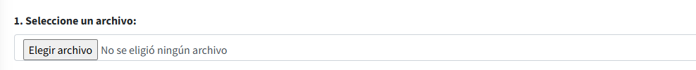{: .clickable-image}

### **Seleccione la fecha del acompañamiento:**

- Haga clic en el campo de fecha que muestra el formato **dd/mm/aaaa**.
- El sistema desplegará un calendario interactivo {:.inline-img}.
- Seleccione el día, mes y año correspondiente a la visita de acompañamiento realizada.

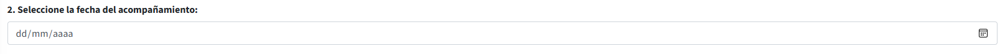{: .clickable-image}

### **Seleccione los aprendices a los cuales se les cargará el archivo:**

El sistema mostrará una tabla con los aprendices encontrados que incluye las siguientes columnas:

- **Ficha:** Número de ficha del programa de formación
- **Documento:** Número de documento de identidad del aprendiz
- **Nombres:** Nombres del aprendiz
- **Apellidos:** Apellidos del aprendiz
- **Seleccionar:** Casilla de verificación para seleccionar al aprendiz

**Para seleccionar aprendices:**

- Revise la información en la tabla para confirmar que corresponde al aprendiz.
- Marque la casilla **☐ Seleccionar** ubicada en la columna derecha de la fila correspondiente al aprendiz.
- Puede seleccionar múltiples aprendices si realizó el acompañamiento a varios de ellos en la misma visita.
- Para seleccionar todos los aprendices mostrados, marque la casilla **☐ Seleccionar** ubicada en el encabezado de la tabla.

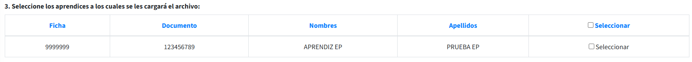{: .clickable-image}

### **Escriba la observación correspondiente:**

- Haga clic en el campo de texto amplio que muestra el texto guía "Ingrese texto...".
- Digite sus observaciones detalladas sobre el acompañamiento realizado.
- Sea claro, específico y objetivo en sus observaciones.

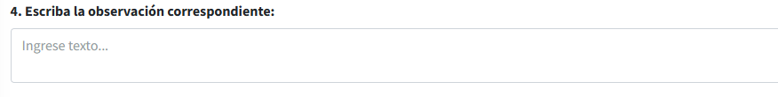{: .clickable-image}

## 6️⃣ **Guardar el acompañamiento**

Una vez completados todos los campos requeridos del formulario, haga clic en el botón azul 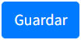{:.inline-img} ubicado en la parte inferior del formulario.

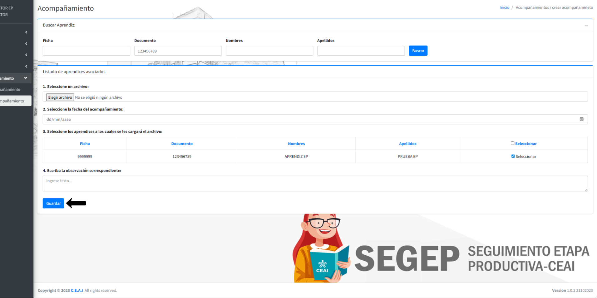{: .clickable-image}

