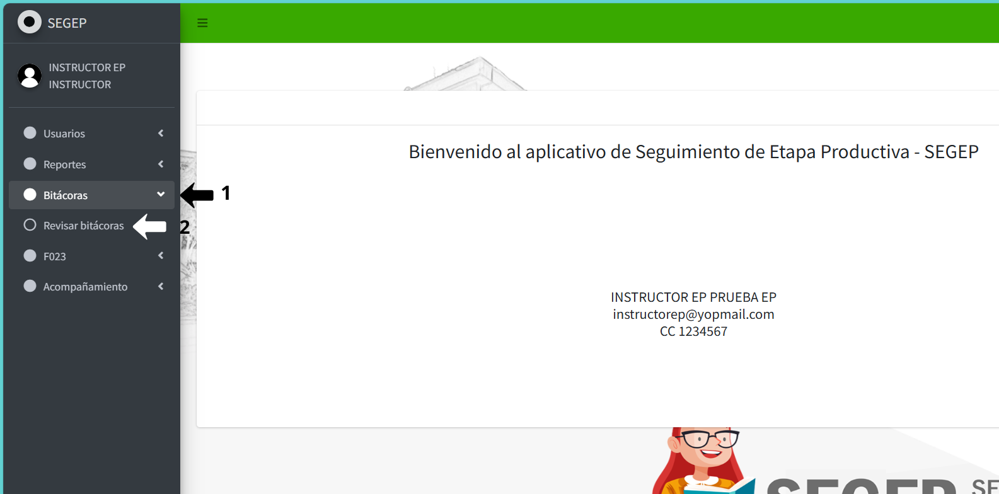
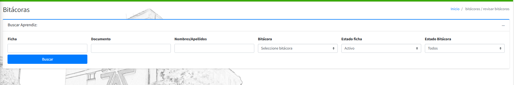
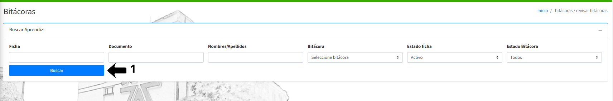
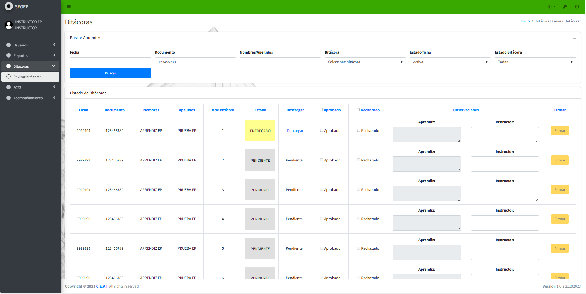

# 📘 REVISIÓN DE BITÁCORAS

Este instructivo explica el procedimiento paso a paso para que el instructor revise, apruebe o rechace las bitácoras quincenales cargadas por los aprendices en etapa productiva. 

## 1️⃣ **Acceder al Módulo de Bitácoras**

### **Navegar al menú de bitácoras**

Asegúrese de haber iniciado sesión en el sistema SEGEP con sus credenciales de instructor. En el menú lateral izquierdo, localice y haga clic en la opción **Bitácoras**, se desplegará un submenú. Haga clic en la opción **Revisar bitácoras**.

{: .clickable-image}

El sistema lo redirigirá a la interfaz principal de revisión de bitácoras.

## 2️⃣ **Interfaz de Búsqueda de Bitácoras**

La sección de búsqueda contiene los siguientes filtros:

- **Ficha:** Número de ficha del programa
- **Documento:** Número de documento del aprendiz
- **Nombres/Apellidos:** Nombre o apellido del aprendiz
- **Bitácora:** Número de bitácora específico (1-12)
- **Estado ficha:** Estado del aprendiz (Activo, Inactivo, etc.)
- **Estado Bitácora:** Estado de la bitácora **(PENDIENTE, ENTREGADO, APROBADO y RECHAZADO)**

{: .clickable-image}

### **Ejecutar la búsqueda**

Una vez configurados los filtros, haga clic en el botón azul {:.inline-img}.

{: .clickable-image}

## 3️⃣ **Listado de Bitácoras**

### **Estructura de la tabla**

La tabla muestra las siguientes columnas:

**Información del aprendiz:**

- **Ficha:** Número de ficha
- **Documento:** Número de documento
- **Nombres:** Nombres del aprendiz
- **Apellidos:** Apellidos del aprendiz

**Información de la bitácora:**

- **# de Bitácora:** Número quincenal (1-12)
- **Estado:** Estado actual
- **Descargar:** Enlace de descarga

**Acciones:**

- **☐ Aprobado:** Casilla para aprobar
- **☐ Rechazado:** Casilla para rechazar
- **Observaciones:** Campos de texto para aprendiz e instructor
- **Firmar:** Botón para guardar la revisión

{: .clickable-image}

## 4️⃣ **Guardar la revisión de Bitácoras**

Para garantizar que toda la información evaluada se almacene correctamente en el sistema:

- Revise que todos los campos requeridos estén completos.
- Desplácese hasta la parte inferior de la pantalla.
- Haga clic en el botón azul {:.inline-img} ubicado en la esquina inferior izquierda.
- Espere el mensaje de confirmación indicando que los datos se guardaron exitosamente.
