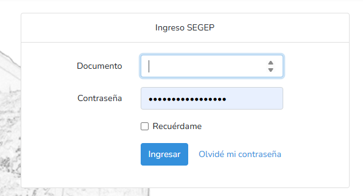
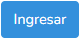
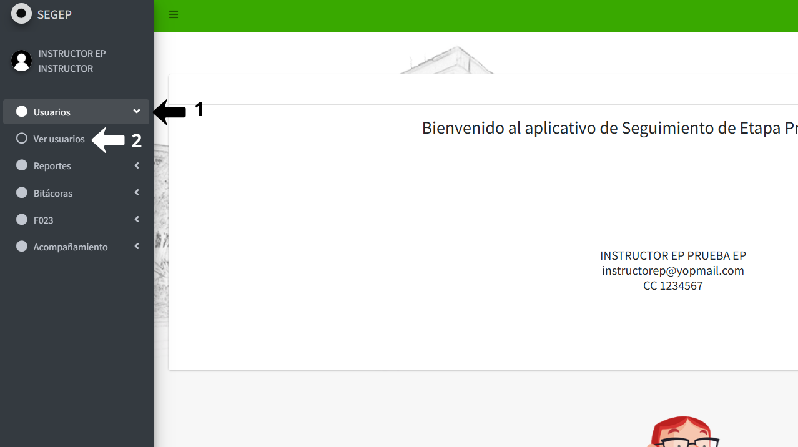
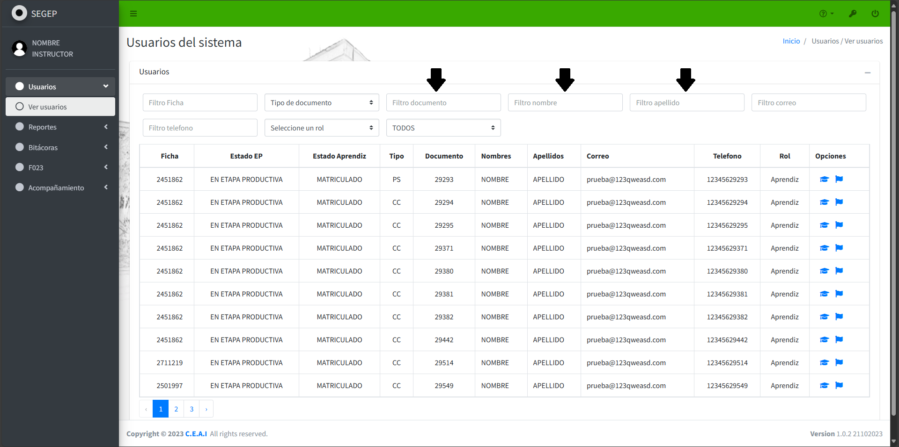
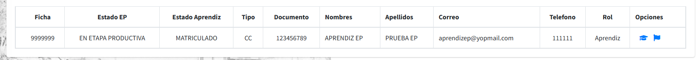
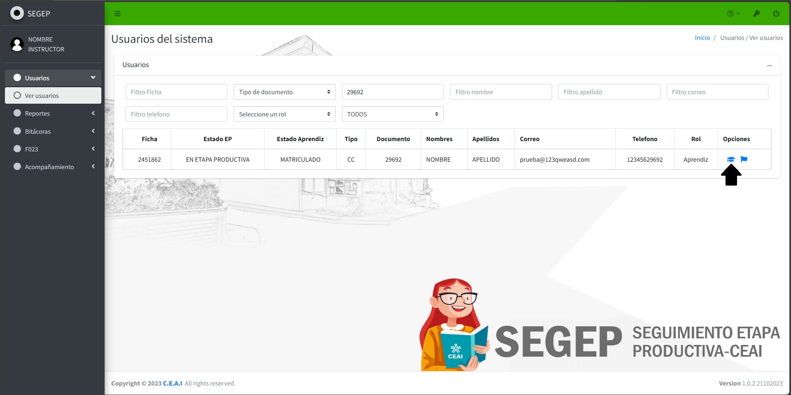
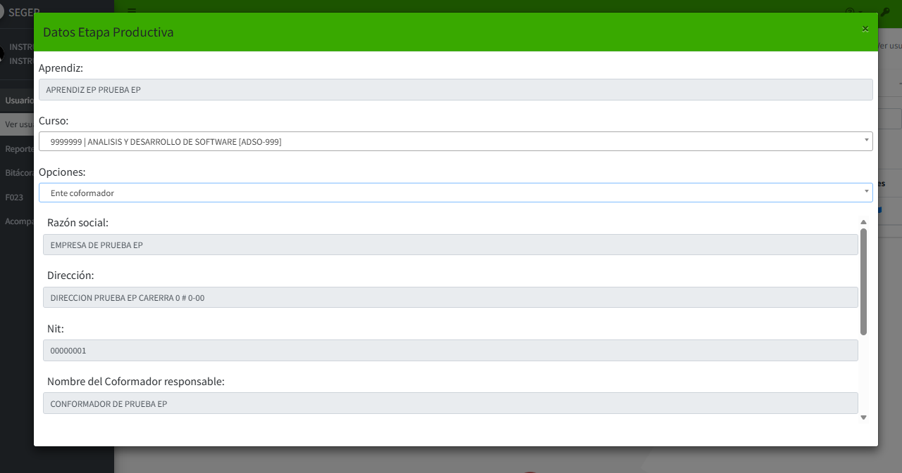

# 📘 INICIO DE SESIÓN 

Este instructivo explica el procedimiento paso a paso para que el instructor acceda al sistema SEGEP 

## 1️⃣ **Ingreso al Sistema**

### **Acceder al sistema SEGEP**

Acceda al sistema a través del siguiente enlace: [https://productiva.appsceai.com/public/usuarios](https://productiva.appsceai.com/public/usuarios)

### **Ingresar las credenciales**

En la interfaz de inicio de sesión, complete los siguientes campos con sus credenciales correspondientes a su rol de instructor:

- **Usuario:** Ingrese su nombre de usuario asignado por el administrador del sistema
- **Contraseña:** Ingrese su contraseña de acceso

{: .clickable-image}

Una vez ingresados los datos, haga clic en el botón azul {:.inline-img} para acceder al sistema.

## 2️⃣ **Acceder a la gestión de aprendices**

Para gestionar los documentos F023 de los aprendices, diríjase al panel lateral ubicado en la parte izquierda de la interfaz y haga clic en la opción **Usuarios**  y luego en **Ver usuarios**.

{: .clickable-image}

El sistema mostrará la lista completa de aprendices registrados en el aplicativo.

## 3️⃣ **Localización del Aprendiz**

### **Utilizar los filtros de búsqueda**

Para localizar al aprendiz, utilice los filtros de búsqueda disponibles en la parte superior de la tabla. Estos filtros le permiten realizar búsquedas precisas y rápidas.

Los filtros disponibles son:

- **Ficha:** Ingrese el número de ficha del programa de formación
- **Tipo de documento:** Seleccione el tipo de identificación (C.C., T.I., etc.)
- **Nombres y apellidos:** Ingrese el nombre completo o parcial del aprendiz
- **Correo electrónico:** Ingrese el email registrado del aprendiz
- **Teléfono:** Ingrese el número de contacto del aprendiz
- **Estado:** Seleccione "EN ETAPA PRODUCTIVA" para filtrar únicamente aprendices activos

{: .clickable-image}

### **Identificar al aprendiz en la lista**

Una vez aplicados los filtros, el sistema mostrará los resultados en una tabla con la siguiente información:

- Nombre completo del aprendiz
- Número de documento
- Ficha asociada
- Programa de formación
- Estado actual
- Opciones disponibles

{: .clickable-image}

## 4️⃣ **Acceder a las Opciones del Aprendiz**

### **Abrir el menú de opciones**

Una vez localizado el aprendiz en la lista de resultados, identifique la columna **Acciones** u **Opciones** ubicada al lado derecho de la fila correspondiente.

Haga clic en el botón **Opciones** representado generalmente con un ícono de birrete académico {:.inline-img}.

{: .clickable-image}

### **Menú Datos de Etapa Productiva**

El sistema mostrara el interfaz del menú con los datos de etapa productiva con las opciones disponibles del aprendiz. Este menú incluye:

- **Aprendiz:** En esta sección se visualiza el nombre completo del aprendiz
- **Curso:**  En esta sección se muestra el número de ficha junto con el nombre del programa de formación del aprendiz
- **Opciones:** Menú desplegable con las diferentes secciones disponibles para gestionar al aprendiz, tales como:
    - **Datos básicos:** Información general del aprendiz
    - **Ente Coformador:** Información del ente coformador (verbo para unir estas palabras) donde realiza la etapa productiva
    - **Bitácoras:** Revisión de bitácoras quincenales
    - **F-023:** Gestión de formatos de seguimiento y evaluación
    - **Acompañamiento:** Registro de visitas y acompañamientos realizados
    - **Documentos Certificación:** Gestión de documentos para certificación
- **Fecha de inicio de etapa productiva:** Fecha en que el aprendiz inició su etapa productiva
- **Fecha de Fin de etapa productiva (Aproximada):** Fecha en que el aprendiz finaliza su etapa
- **Nombre del instructor encargado del seguimiento:** Nombre del instructor asignado para el seguimiento del aprendiz
- **Qué alternativa de Etapa Productiva está ejecutando?:** Descripción de la modalidad de etapa productiva que está realizando el aprendiz

##  5️⃣ **Consultar Información del Ente Coformador**

En la lista desplegable de **Opciones**, seleccione la opción **Ente coformador**. Esta sección permite revisar los datos completos del ente coformador asociado al aprendiz:

- **Razón social:** Nombre legal de la empresa o entidad
- **Dirección:** Ubicación física del ente coformador
- **NIT:** Número de Identificación Tributaria
- **Nombre del responsable:** Persona encargada del aprendiz en el ente coformador
- **Cargo:** Cargo que desempeña el responsable en la organización
- **Teléfono:** Número de contacto del responsable o de la empresa
- **Correo electrónico:** Email de contacto del responsable o de la empresa

{: .clickable-image}