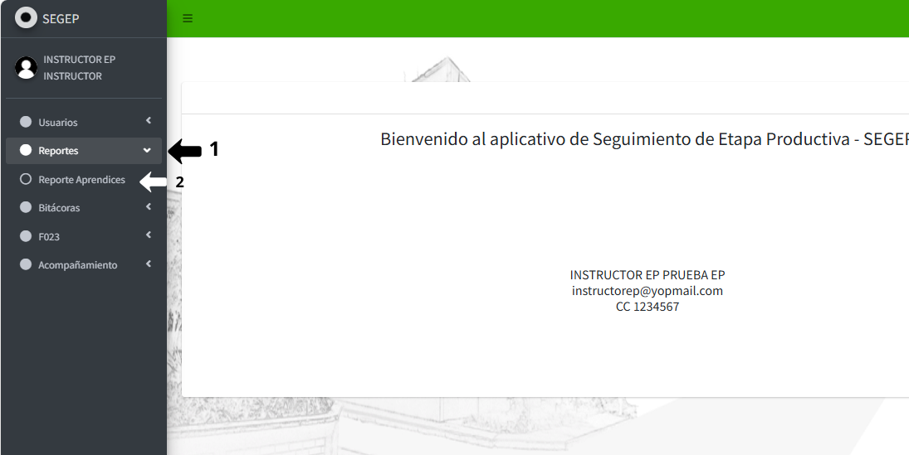
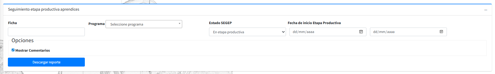
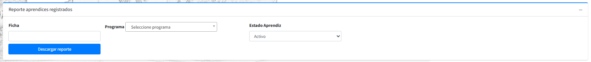
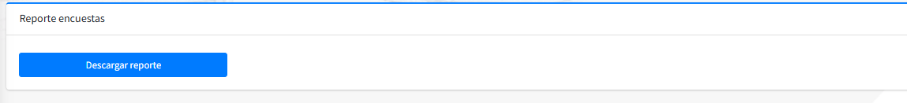

# 📘 REPORTES 

Este instructivo explica el procedimiento paso a paso para que el instructor visualice y descargue reportes de aprendices en etapa productiva desde el sistema SEGEP. Los reportes permiten consultar información detallada de los aprendices bajo su supervisión, facilitando el seguimiento y la gestión académica.

## 1️⃣ **Navegar al menú de reportes**

Localice el menú lateral izquierdo de la interfaz. En este menú encontrará las diferentes opciones disponibles. Identifique y haga clic en la opción **Reportes** ubicada en el menú lateral izquierdo.

{: .clickable-image}

El sistema lo redirigirá a la interfaz principal del módulo de reportes, donde podrá visualizar los diferentes tipos de reportes disponibles.

## 2️⃣ **Generar Reporte de Seguimiento de Etapa Productiva**

### **Acceder a la sección del reporte**

Localice la sección titulada **"Seguimiento etapa productiva aprendices"** en la parte superior de la interfaz.

{: .clickable-image}

**Configurar los filtros de búsqueda**

El sistema ofrece varios filtros para la información que desea consultar. Configure los filtros según sus necesidades:

- **Ficha:** Ingrese el número de ficha del programa de formación que desea consultar.
- **Programa:** Utilice el campo desplegable **Programa** para seleccionar el programa de formación específico.
- **Estado SEGEP:** En este campo permite filtrar aprendices según su estado actual en el sistema. Por defecto, este campo viene preconfigurado con la opción **"En etapa productiva"** o **"Sin etapa productiva"**.
- **Filtro por Fecha de Inicio de Etapa Productiva:** El sistema permite filtrar por rango de fechas de inicio de la etapa productiva:
    - **Fecha inicial (desde):**
    - **Fecha final (hasta):**
- **Mostrar Comentarios:** Debajo de los filtros principales, encontrará una casilla de verificación con la opción **"Mostrar Comentarios"**.

###  **Generar y descargar el reporte**

Una vez configurados todos los filtros según sus necesidades, haga clic en el botón azul {: .inline-img} ubicado en la parte inferior de la sección.

## 3️⃣ **Generar Reporte de Aprendices Registrados**

### **Acceder a la sección del reporte**

Desplácese hacia abajo en la interfaz de reportes hasta localizar la sección titulada **"Reporte aprendices registrados"**.

{: .clickable-image}

- **Ficha:** En el campo **Ficha**, ingrese el número de ficha del programa de formación que desea consultar.
- **Filtro por Programa:** Haga clic en el campo desplegable **Programa** y seleccione el programa de formación específico.
- **Filtro por Estado Aprendiz:** Este campo permite filtrar por el estado del aprendiz **Activo** o **Inactivo** en el sistema.

### **Generar y descargar el reporte**

Una vez configurados los filtros, haga clic en el botón azul {: .inline-img} ubicado en la parte inferior de esta sección.

## 4️⃣ **Generar Reporte de Encuestas**

### **Acceder a la sección del reporte**

Continúe desplazándose hacia abajo en la interfaz hasta localizar la sección titulada **"Reporte encuestas"**.

{: .clickable-image}

### **Generar y descargar el reporte**

Haga clic directamente en el botón azul {: .inline-img}  para generar y descargar el archivo de encuestas.
